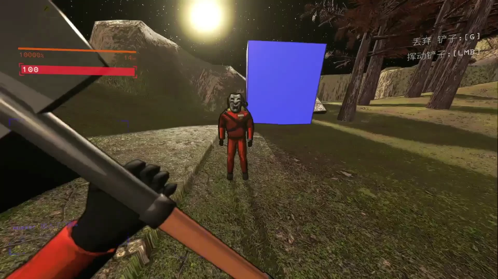

<h1 align="center">Enemy Health Bar</h1>

  
  
  
  

  
  
  

<strong>中文</strong>

### 演示

<table>
  <tr>
    <td align="center"></td>
  </tr>
</table>

### 常用配置

| 配置 | 默认值 | 说明 |
|:--|:--|:--|
| `BarStyle` | `Segmented` | `Segmented` 新风格分段血条，`Classic` 传统红色血条 |
| `DisplayMode` | `HorizontalBar` | `HorizontalBar` 头顶横条，`VerticalSideBar` 身旁竖条，`NumbersOnly` 纯数字 |
| `HealthTextFormat` | `CurrentAndMax` | `CurrentAndMax` 当前 / 满血，`CurrentOnly` 仅当前，`PercentOnly` 百分比 |
| `MaxDistance` | `35` | 最大显示距离，0 或更低表示不限制 |
| `MaxHealthMode` | `Hybrid` | `VanillaStrict` 原版满血值，`Adaptive` 按实际观察，`Hybrid` 原版特例 + 适应改血模组 |
| `HostAuthoritySync` | `true` | 主机与客机都安装时同步主机端血量 |

配置保存在 `BepInEx/config/auuueser.lethalcompany.enemyhealthbar.cfg`，修改后立即生效；安装 LethalConfig 后也可在游戏内调整。

### 安装

通过 **r2modman / Thunderstore Mod Manager** 安装，需要 **BepInExPack 5.4.2100**。手动安装时，将 `EnemyHealthBar.dll` 与 `EnemyHealthBars.Core.dll` 放入 `BepInEx/plugins/EnemyHealthBar/`。

只在客机安装即可使用；主机也安装时血量最准确。

### 兼容

- [LC_Chinese_Project](https://thunderstore.io/c/lethal-company/p/Aueser/LC_Chinese_Project/)：自动使用中文配置与说明。
- [LethalConfig](https://thunderstore.io/c/lethal-company/p/AinaVT/LethalConfig/)：在游戏内修改全部配置，保存后立即生效。

遇到问题请在 [Issues](https://github.com/Auuueser/Enemy-Health-Bar/issues) 附上复现步骤、模组列表及 `BepInEx/LogOutput.log`。项目采用 [GPL-3.0](https://github.com/Auuueser/Enemy-Health-Bar/blob/main/LICENSE) 许可。

<strong>English</strong>

### Demo

<table>
  <tr>
    <td align="center"></td>
  </tr>
</table>

### Common settings

| Setting | Default | Description |
|:--|:--|:--|
| `BarStyle` | `Segmented` | `Segmented` new segmented bar, `Classic` original red bar |
| `DisplayMode` | `HorizontalBar` | `HorizontalBar` above the enemy, `VerticalSideBar` beside it, `NumbersOnly` text only |
| `HealthTextFormat` | `CurrentAndMax` | `CurrentAndMax` current / max, `CurrentOnly`, `PercentOnly` |
| `MaxDistance` | `35` | Maximum display distance; 0 or below for no limit |
| `MaxHealthMode` | `Hybrid` | `VanillaStrict` vanilla max health, `Adaptive` observed health, `Hybrid` vanilla special cases plus modded health |
| `HostAuthoritySync` | `true` | Use the host's health when host and client both have the mod |

Settings are saved to `BepInEx/config/auuueser.lethalcompany.enemyhealthbar.cfg` and apply immediately; with LethalConfig they can also be changed in game.

### Installation

Install through **r2modman / Thunderstore Mod Manager**. Requires **BepInExPack 5.4.2100**. For a manual install, place `EnemyHealthBar.dll` and `EnemyHealthBars.Core.dll` in `BepInEx/plugins/EnemyHealthBar/`.

Works when only clients install it; health is most accurate when the host installs it too.

### Compatibility

- [LC_Chinese_Project](https://thunderstore.io/c/lethal-company/p/Aueser/LC_Chinese_Project/): Chinese configuration names and descriptions are used automatically.
- [LethalConfig](https://thunderstore.io/c/lethal-company/p/AinaVT/LethalConfig/): change every setting in game; changes apply on save.

Report problems through [Issues](https://github.com/Auuueser/Enemy-Health-Bar/issues), including reproduction steps, your mod list and `BepInEx/LogOutput.log`. Licensed under [GPL-3.0](https://github.com/Auuueser/Enemy-Health-Bar/blob/main/LICENSE). Build notes: [BUILDING.md](BUILDING.md).

